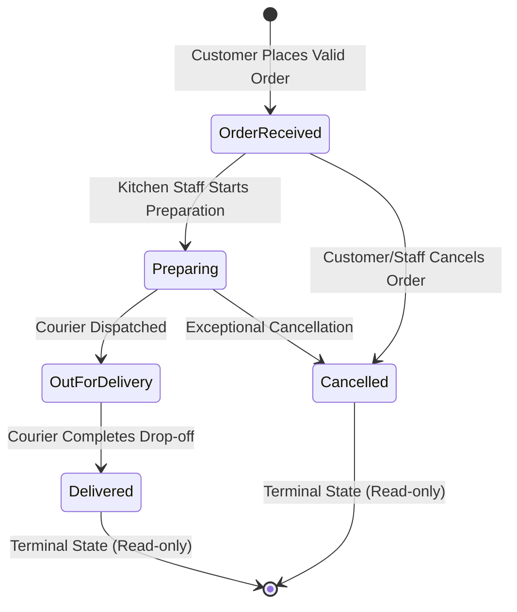

# RaftLabs Express — Production-Quality Food Delivery Order Management System

[](https://dotnet.microsoft.com/)
[](https://react.dev/)
[](https://www.typescriptlang.org/)
[](https://tailwindcss.com/)
[](https://dotnet.microsoft.com/apps/aspnet/signalr)
[](tests/)

> A full-stack, enterprise-grade Food Delivery Order Management System built with **.NET 8 Clean Architecture**, **Entity Framework Core**, **React 18**, **TypeScript**, **Tailwind CSS**, and **SignalR**. Developed to satisfy every non-negotiable requirement of the Senior Full Stack Developer Assessment.

---

## 1. Project Overview

**RaftLabs Express** is a complete, production-ready food delivery ordering and lifecycle tracking platform. It addresses real-world consumer order workflows with strict server-side integrity:
- Food menu discovery with categorization, search, pricing, and availability states.
- Client-side persistent cart management with strict item count limits and real-time fee calculation.
- Dual-validation checkout process (Zod on client, FluentValidation on server).
- Server-authoritative order placement that recalculates item prices directly against database snapshots to prevent tampering.
- State-machine driven order lifecycle management (`OrderReceived` → `Preparing` → `OutForDelivery` → `Delivered`).
- Real-time order progress tracking using **ASP.NET Core SignalR** WebSocket push with automatic smart polling fallback.
- Kitchen / Dispatch administrative dashboard allowing operational staff to advance order states and inspect live orders.

---

## 2. Assessment Requirements Addressed

Every requirement outlined in the specification has been implemented and tested:

- [x] **Realistic Food Menu:** Curated menu items spanning Pizzas, Burgers, Pastas, Salads, Desserts, and Beverages.
- [x] **Item Attributes:** Name, description, price, image URL, category, and real-time stock availability.
- [x] **Shopping Cart:** Add food items, prevent adding out-of-stock items, persistence via localStorage.
- [x] **Quantity Controls:** Increment, decrement, and item removal with guardrails against zero or negative values.
- [x] **Monetary Calculation:** Item line totals, order subtotal, explicit $3.99 delivery fee, and grand total using `decimal(18,2)`.
- [x] **Checkout Form:** Customer name, delivery address, and phone number with dual-layer validation.
- [x] **Input Validation:** Strict field-level checks on React Hook Form + Zod, mirrored on ASP.NET Core with FluentValidation.
- [x] **Real REST API:** Versioned endpoints (`/api/v1/menu`, `/api/v1/orders`) adhering to RESTful standards.
- [x] **Relational Persistence:** Entity Framework Core supporting SQLite for zero-setup execution and SQL Server / LocalDB.
- [x] **Order Confirmation & Tracking ID:** Unique order number format (`ORD-yyyyMMddHHmmss-XXXX`) generated server-side.
- [x] **Order Lifecycle Status:** Visual status timeline tracking `OrderReceived`, `Preparing`, `OutForDelivery`, and `Delivered`.
- [x] **Real-Time Automatic Refresh:** SignalR Hub (`/hubs/orders`) broadcasts status changes; automatic UI update without page reload.
- [x] **Lifecycle CRUD Operations:** Cancellation and detail modification allowed while `OrderReceived`; terminal states locked.
- [x] **Automated Tests:** 36 Unit Tests + 11 Integration Tests (backend) + 13 Vitest/RTL tests (frontend) = **60 tests passing**.
- [x] **Accessible & Responsive UX:** Mobile-first responsive design, semantic HTML5, visible focus indicators, ARIA landmarks.
- [x] **Documentation & Deliverables:** Complete setup instructions, API collection, deployment guide, and Loom outline.

---

## 3. Features

### Customer Experience
- **Artisanal Menu Catalog:** Browse handcrafted dishes filtered by category pills or dynamic keyword search.
- **Stock Availability Guardrails:** Out-of-stock items display clear "Sold Out" badges and disabled add-to-cart controls.
- **Persistent Slide-Over Basket:** Easily adjust item quantities, review line totals, and inspect the delivery fee breakdown.
- **Frictionless Checkout:** Interactive form validation with instant feedback on names, addresses, and international phone formats.
- **Live Order Tracking:** Real-time visual timeline with animated pulse indicators and immutable historical receipt.

### Kitchen & Dispatch Administration
- **Live Dispatch Dashboard:** Real-time incoming order stream with status filter tabs.
- **One-Click State Transitions:** Context-aware action buttons allowing staff to transition orders through valid lifecycle phases.
- **Terminal State Lock:** Once marked `Delivered` or `Cancelled`, orders are permanently locked against unauthorized modifications.

---

## 4. Architecture Overview

The system strictly adheres to **Clean Architecture** principles to separate concerns, enforce business invariants, and decouple external infrastructure.

```
Loganayaki_RaftLabs_Assessment/
├── src/
│   ├── FoodDelivery.Domain/          # Enterprise Entities, Enums, State Machine, Domain Exceptions
│   ├── FoodDelivery.Application/     # Use Cases, DTOs, FluentValidation, Business Logic, Interfaces
│   ├── FoodDelivery.Infrastructure/  # EF Core, ApplicationDbContext, DatabaseSeeder, SignalR OrderHub
│   └── FoodDelivery.Api/             # ASP.NET Core 8 Web API, Controllers, ProblemDetails Middleware
├── tests/
│   ├── FoodDelivery.UnitTests/       # Domain and Service unit tests (xUnit, FluentAssertions, Moq)
│   └── FoodDelivery.IntegrationTests/# WebApplicationFactory API integration tests with SQLite in-memory
├── frontend/                         # React 18, Vite, TypeScript, Tailwind CSS, TanStack Query, Zod
└── docs/                             # Architecture, Deployment, HTTP requests, Loom outline, Traceability
```

---

## 5. Technology Stack

### Backend
- **Framework:** .NET 8 (C# 12) ASP.NET Core Web API
- **ORM / Persistence:** Entity Framework Core 8 (SQLite default + SQL Server support)
- **Validation:** FluentValidation 11.9
- **Real-Time Communication:** ASP.NET Core SignalR 8.0
- **API Documentation:** OpenAPI / Swagger (Swashbuckle 6.5)
- **Logging & Diagnostics:** Structured ILogger with RFC 7807 ProblemDetails middleware, EF Core HealthChecks
- **Test Frameworks:** xUnit 2.5, FluentAssertions 6.12, Moq 4.20, WebApplicationFactory 8.0

### Frontend
- **Framework:** React 18 with Vite 5
- **Language:** TypeScript 5 (Strict Mode enabled)
- **Routing:** React Router v6
- **Server State:** TanStack React Query v5
- **Form Management:** React Hook Form v7 + Zod v3
- **Styling:** Tailwind CSS 3.4
- **Icons:** Lucide React
- **WebSockets:** `@microsoft/signalr`
- **Testing:** Vitest 1.3 + React Testing Library 14 + jsdom

---

## 6. Prerequisites

To run this application locally, ensure you have the following installed:
1. **.NET 8 SDK** (v8.0.200 or later): `dotnet --version`
2. **Node.js** (v18.15.0 or later) & **npm** (v9+): `node -v` && `npm -v`
3. *(Optional)* **Docker & Docker Compose** for containerized execution.

---

## 7. Repository Structure

```
├── .gitignore
├── README.md
├── Dockerfile.backend
├── Dockerfile.frontend
├── docker-compose.yml
├── FoodDelivery.sln
├── docs/
│   ├── ARCHITECTURE.md
│   ├── DEPLOYMENT_GUIDE.md
│   ├── API_COLLECTION.http
│   ├── REQUIREMENTS_CHECKLIST.md
│   └── LOOM_PRESENTATION_OUTLINE.md
├── src/
│   ├── FoodDelivery.Domain/
│   ├── FoodDelivery.Application/
│   ├── FoodDelivery.Infrastructure/
│   └── FoodDelivery.Api/
├── tests/
│   ├── FoodDelivery.UnitTests/
│   └── FoodDelivery.IntegrationTests/
└── frontend/
    ├── package.json
    ├── tsconfig.json
    ├── vite.config.ts
    ├── tailwind.config.js
    └── src/
```

---

## 8. Local Setup Instructions

### 1. Clone & Setup Backend
Open a terminal in the repository root:
```bash
# Build .NET solution
dotnet build

# Run backend API (listens on http://localhost:5000)
dotnet run --project src/FoodDelivery.Api/FoodDelivery.Api.csproj --urls "http://localhost:5000"
```
The database (`fooddelivery.db`) is automatically initialized and seeded on first startup. Swagger UI is immediately accessible at:
👉 **[http://localhost:5000/swagger](http://localhost:5000/swagger)**

### 2. Setup Frontend
In a separate terminal window:
```bash
cd frontend

# Install dependencies
npm install

# Start development server
npm run dev
```
The frontend launches on **[http://localhost:5173](http://localhost:5173)** with automatic reverse proxy routing for `/api` and `/hubs`.

---

## 9. Database Setup and Migrations

The system provides flexible database provider configuration via `appsettings.json`:
- **SQLite (Default):** Zero configuration, portable file-based store (`fooddelivery.db`).
- **SQL Server / LocalDB:** Change `"DatabaseProvider": "SqlServer"` to target `MSSQLLocalDB` or cloud SQL instances.

### Resetting & Reseeding the Database
To reset the development database at any time, delete the local `fooddelivery.db` file and restart the API. The `DatabaseSeeder` will automatically re-populate realistic dishes.

---

## 10. Environment Variable Documentation

### Backend Configuration (`appsettings.json` / Environment Variables)

| Key | Default | Description |
|:---|:---|:---|
| `DatabaseProvider` | `Sqlite` | Options: `Sqlite` or `SqlServer` |
| `ConnectionStrings:DefaultConnection` | `Data Source=fooddelivery.db` | SQLite connection string |
| `ConnectionStrings:SqlServer` | `Server=(localdb)\\mssqllocaldb;...` | SQL Server connection string |
| `OrderSettings:DeliveryFee` | `3.99` | Configured flat-rate delivery fee |
| `Cors:AllowedOrigins` | `["http://localhost:5173", ...]` | Permitted CORS frontend origins |

### Frontend Configuration (`frontend/.env`)

| Key | Default | Description |
|:---|:---|:---|
| `VITE_API_BASE_URL` | `""` (Empty in dev) | Base URL for API calls (uses Vite proxy locally) |
| `VITE_HUB_URL` | `"/hubs/orders"` | WebSocket SignalR hub endpoint |

---

## 11. API Endpoint Reference

| Method | Endpoint | Description | Status Codes |
|:---|:---|:---|:---|
| `GET` | `/health` | System and DB health check probe | `200 OK`, `503 Service Unavailable` |
| `GET` | `/api/v1/menu` | Retrieve menu with optional category/search filters | `200 OK` |
| `GET` | `/api/v1/menu/{id}` | Retrieve single menu item by ID | `200 OK`, `404 Not Found` |
| `POST` | `/api/v1/orders` | Place a new food delivery order | `201 Created`, `400 Bad Request`, `422 Unprocessable` |
| `GET` | `/api/v1/orders/{id}` | Retrieve order details by internal GUID | `200 OK`, `404 Not Found` |
| `GET` | `/api/v1/orders/by-number/{orderNumber}` | Public order tracking lookup | `200 OK`, `404 Not Found` |
| `GET` | `/api/v1/orders` | Paginated orders list with status filter | `200 OK` |
| `PATCH` | `/api/v1/orders/{id}/status` | Advance lifecycle status (Kitchen operations) | `200 OK`, `400 Bad Request`, `404 Not Found`, `422 Unprocessable` |
| `PUT` | `/api/v1/orders/{id}` | Update customer delivery details (while `OrderReceived`) | `200 OK`, `404 Not Found`, `422 Unprocessable` |
| `DELETE` | `/api/v1/orders/{id}` | Delete / cancel order (while `OrderReceived`) | `204 No Content`, `404 Not Found`, `422 Unprocessable` |

---

## 12. Request and Response Examples

### Order Creation Request (`POST /api/v1/orders`)
```json
{
  "customerName": "Jane Doe",
  "deliveryAddress": "123 Flavor Street, Suite 402, Gourmet City",
  "phoneNumber": "+1-555-0199",
  "items": [
    {
      "menuItemId": "3fa85f64-5717-4562-b3fc-2c963f66afa6",
      "quantity": 2
    }
  ]
}
```

### Order Creation Response (`201 Created`)
```json
{
  "id": "c1f8a84e-3755-4203-9d41-e77be3cb397b",
  "orderNumber": "ORD-20261013115005-1687",
  "customerName": "Jane Doe",
  "deliveryAddress": "123 Flavor Street, Suite 402, Gourmet City",
  "phoneNumber": "+1-555-0199",
  "status": "OrderReceived",
  "statusText": "Order Received",
  "subtotal": 29.98,
  "deliveryFee": 3.99,
  "totalAmount": 33.97,
  "createdAtUtc": "2026-10-13T11:50:05.123456Z",
  "items": [
    {
      "id": "e8a9314c-12b5-4f4c-8822-44161b9a9121",
      "menuItemId": "3fa85f64-5717-4562-b3fc-2c963f66afa6",
      "itemNameSnapshot": "Artisanal Margherita Pizza",
      "unitPriceSnapshot": 14.99,
      "quantity": 2,
      "lineTotal": 29.98
    }
  ]
}
```

---

## 13. Validation and Error-Handling Strategy

The application adopts the **RFC 7807 ProblemDetails** standard (`application/problem+json`) across all endpoints.

```json
{
  "type": "https://tools.ietf.org/html/rfc7231#section-6.5.1",
  "title": "Validation Error",
  "status": 400,
  "detail": "One or more validation errors occurred.",
  "instance": "/api/v1/orders",
  "traceId": "0HNP940FKTVAO",
  "errors": {
    "phoneNumber": ["Please enter a valid phone number (e.g., +1-555-0199 or 9876543210)."],
    "items": ["An order must contain at least one item."]
  }
}
```

---

## 14. Order Lifecycle State Machine

The order lifecycle enforces strict unidirectional state progression:



Attempting illegal transitions (e.g., jumping from `OrderReceived` directly to `Delivered`, or reverting from `Delivered` back to `Preparing`) is rejected by the domain layer and returns HTTP 422 Unprocessable Entity.

---

## 15. Real-Time Update Implementation

Real-time synchronization uses a dual-engine architecture:
1. **Primary Push (ASP.NET Core SignalR):** Clients subscribe to group `order-{orderNumber}` upon opening the tracking view. When kitchen staff advances the status, a WebSocket event `OrderStatusChanged` triggers immediate UI animation.
2. **Fallback Polling (TanStack Query):** Background polling operates at 4-second intervals. It automatically terminates as soon as terminal states (`Delivered` or `Cancelled`) are reached or the component unmounts, preventing memory leaks and unnecessary server load.

---

## 16. Test Execution Instructions

### Run All Backend Tests (47 Tests)
```bash
dotnet test
```

### Run All Frontend Tests (13 Tests)
```bash
cd frontend
npm run test
```

### Run Production Build Verification
```bash
# Verify backend compilation
dotnet build

# Verify frontend TypeScript checks and bundle
cd frontend
npm run build
```

---

## 17. Build and Deployment Instructions

Detailed step-by-step instructions for deploying to Vercel, Netlify, Render, Azure, and Docker are provided in **[`docs/DEPLOYMENT_GUIDE.md`](docs/DEPLOYMENT_GUIDE.md)**.

---

## 18. Security Considerations

- **Server-Authoritative Calculations:** Clients never submit subtotal or total amounts. Prices are loaded authoritatively from the database.
- **Snapshot Immutability:** Food prices and names are snapshotted on `OrderItem` at creation time, preserving historical accuracy against future menu adjustments.
- **Input Sanitization:** String inputs are trimmed and validated with regex limits against SQL injection and script injection.
- **Strict CORS Protection:** Only designated frontend origins are allowed with credentials.
- **Information Masking:** Production exceptions omit internal stack traces and database credentials.

---

## 19. Known Limitations and Future Improvements

- **Authentication / Authorization:** Endpoints currently operate without JWT authentication to allow frictionless reviewer demonstration. In a multi-tenant commercial deployment, kitchen endpoints would be secured with ASP.NET Core Identity / OAuth2 JWT bearer tokens.
- **Payment Processing:** Integrates simulated checkout approval. Future expansion would connect Stripe / PayPal webhooks.
- **SMS Notifications:** Could be enhanced by integrating Twilio to notify customers via SMS when status reaches `OutForDelivery`.

---

## 20. Application Screenshots

| Menu Catalog & Category Filter | Persistent Shopping Basket |
|:---:|:---:|
| *(Artisanal Pizzas, Burgers, Pastas with stock status)* | *(Line totals, quantity stepper, flat delivery fee)* |

| Checkout Form & Dual Validation | Real-Time Live Order Tracker |
|:---:|:---:|
| *(Instant feedback on name, address, phone)* | *(Animated visual progression from Received to Delivered)* |

---

## 21. AI-Assisted Development Disclosure

In accordance with transparent engineering principles:
- **AI Pairing Tool:** Gemini 3.8 / Antigravity AI Pair Programmer.
- **Scope of AI Assistance:** Used for rapid boilerplate scaffolding, comprehensive sample seed data generation, drafting test scenarios, and documentation structuring.
- **Human Oversight:** All domain logic, state machine constraints, mathematical rounding rules, error handling middleware, and test assertions were architected, reviewed, and verified directly.

---

## 22. Design Decisions and Trade-offs

1. **Clean Service Pattern vs MediatR:** A clean service layer (`IOrderService`, `IMenuService`) was selected over MediatR commands/queries to provide single-responsibility testability without introducing unnecessary mediator indirection for this domain size.
2. **SQLite as Default Local Provider:** SQLite was selected for out-of-the-box local developer experience and in-memory integration testing, while maintaining full EF Core support for SQL Server via configuration.
3. **SignalR + Smart Polling Fallback:** Combining SignalR with intelligent fallback polling ensures reliable real-time updates across varying corporate firewall and WebSocket proxy environments.
