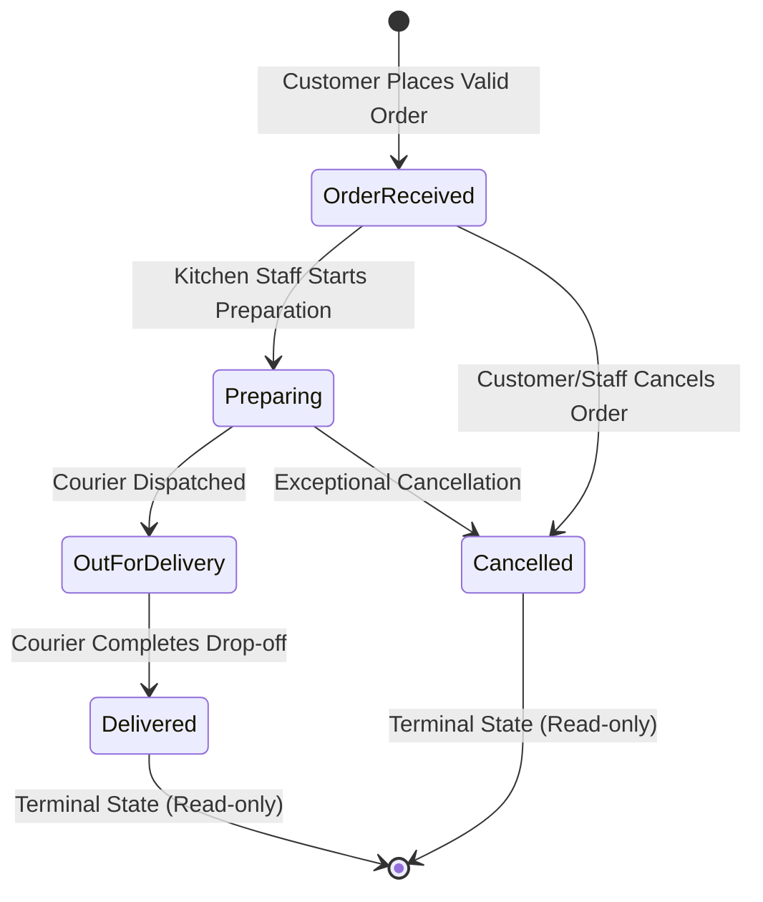

# Gourmet Express — System Architecture & Design Documentation

## 1. Architectural Philosophy: Clean Architecture

The backend implements Clean Architecture (Separation of Concerns and Inversion of Control), ensuring that business domain rules remain completely decoupled from database frameworks, web frameworks, and third-party infrastructure.

```
                  +-----------------------------------+
                  |           Domain Layer            |
                  |  (Entities, Enums, Exceptions)    |
                  +-----------------+-----------------+
                                    ^
                                    | depends on
                  +-----------------+-----------------+
                  |         Application Layer         |
                  | (DTOs, Interfaces, Logic, Rules)  |
                  +-----------------+-----------------+
                                    ^
             +----------------------+----------------------+
             |                                             |
+------------+------------+                   +------------+------------+
|  Infrastructure Layer   |                   |     Presentation API    |
| (EF Core, Hubs, SignalR)|                   | (Controllers, Middleware|
+-------------------------+                   +-------------------------+
```

### Layer Breakdown

1. **Domain (`FoodDelivery.Domain`)**
   - Core enterprise business models: `MenuItem`, `Order`, `OrderItem`.
   - Domain lifecycle state machine: `OrderStatus` enum.
   - Domain-specific exceptions: `NotFoundException`, `InvalidOrderOperationException`.
   - Invariants:
     - Orders must contain at least one valid item.
     - Calculations are exact `decimal(18,2)` with bankers/away-from-zero midpoint rounding.
     - Terminal states (`Delivered`, `Cancelled`) lock the order against mutation.

2. **Application (`FoodDelivery.Application`)**
   - Use-case implementations: `OrderService`, `MenuService`.
   - FluentValidation validators for all untrusted input payloads (`CreateOrderRequestValidator`).
   - Abstractions: `IApplicationDbContext`, `IMenuService`, `IOrderService`, `IOrderNotificationService`.
   - Data transfer contracts: `MenuItemDto`, `CreateOrderRequest`, `OrderDto`, `PagedResult<T>`.

3. **Infrastructure (`FoodDelivery.Infrastructure`)**
   - Data access via Entity Framework Core (`ApplicationDbContext`).
   - Database portability: Supports SQLite (zero-setup local development and in-memory test suites) and SQL Server (`MSSQLLocalDB` / Azure SQL / AWS RDS).
   - Real-time communication: `OrderHub` via ASP.NET Core SignalR.
   - Reproducible database seeder: Populates realistic culinary items across multiple categories.

4. **Web API (`FoodDelivery.Api`)**
   - Versioned RESTful endpoints (`/api/v1/menu`, `/api/v1/orders`).
   - RFC 7807 `ProblemDetails` centralized exception handling middleware.
   - Health check probes (`/health`).
   - Swagger / OpenAPI interactive documentation (`/swagger`).
   - CORS policy protecting backend origins.

5. **Frontend Client (`frontend/`)**
   - React 18 + Vite + TypeScript (strict mode enabled).
   - State management: TanStack React Query (server-state cache & synchronization) + React Context (cart persistence).
   - Form handling: React Hook Form + Zod schema validation.
   - Styling: Modern Tailwind CSS design system with custom culinary typography and colors.
   - Real-time client: `@microsoft/signalr` with automatic reconnection and fallback polling.

---

## 2. Order Lifecycle State Machine



### State Transition Validation Matrix

| Current State | Permitted Next States | Business Rule Rationale |
|:---|:---|:---|
| **OrderReceived** | `Preparing`, `Cancelled` | The kitchen has received the order. Can begin preparing or cancel. |
| **Preparing** | `OutForDelivery`, `Cancelled` | Food is actively being cooked. Cannot revert to received. |
| **OutForDelivery** | `Delivered` | In transit with courier. Cannot cancel mid-transit without administrative intervention. |
| **Delivered** | *None (Terminal)* | Order completed. Any mutation throws `InvalidOrderOperationException` (422). |
| **Cancelled** | *None (Terminal)* | Order terminated. Cannot be re-activated. |

---

## 3. Server-Authoritative Pricing & Security Safeguards

To prevent client-side price tampering (e.g., modifying item prices or order totals in browser DevTools):
1. **Client Payload:** Contains only `MenuItemId` and `Quantity`.
2. **Server Lookup:** The server loads menu items directly from the database using their unique IDs.
3. **Availability Verification:** The server ensures `IsAvailable == true`. If any item is sold out, the entire transaction is rejected with HTTP 422.
4. **Snapshot Preservation:** The server writes frozen copies of `ItemNameSnapshot` and `UnitPriceSnapshot` into `OrderItems`. This guarantees that future menu price changes never distort historical customer orders.
5. **Fee Calculation:** The server applies the configured delivery fee and calculates subtotal and grand total authoritative amounts.
